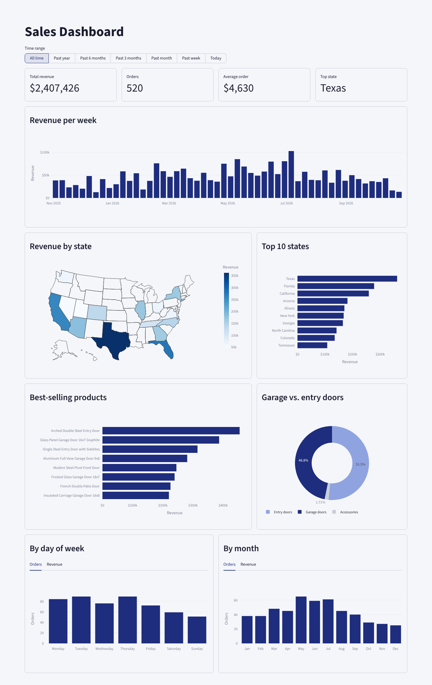

# Shopify Sales Data Pipeline & Dashboard

An end-to-end ETL pipeline for a Shopify Store selling luxury iron doors. It pulls order data from the Shopify GraphQL Admin API, cleans it with pandas, stores it in a SQLite database, and serves it as an interactive Streamlit dashboard. This replaces manual CSV exports from the Shopify admin.



*The screenshot uses made-up sample data. Real store data and API credentials are not included in this repository.*

## How it works

1. **Extract**: `pipeline.py` gets a short-lived access token (OAuth client credentials), then queries the Shopify GraphQL Admin API for the last 7 days of orders. `backfill.py` pulls the full order history once, using cursor-based pagination.
2. **Transform**: nested JSON is flattened with `pd.json_normalize` into two tables, `orders` (one row per order) and `products` (one row per line item). Columns are renamed and prices are converted from text to numbers.
3. **Load**: both tables are saved to `data/sales.db` (SQLite). Each run deletes any existing copy of an order before inserting it, so re-runs never create duplicates and status changes (like pending to paid) are picked up.
4. **Dashboard**: `dashboard.py` reads the database and shows:
   - Total revenue, order count, average order value, and top state
   - Revenue over time (weekly or daily)
   - A U.S. revenue map and the top 10 states
   - Best-selling products and the garage vs. entry door revenue split
   - Orders and revenue by day of week and by month
   - A time range filter (all time, past year, 6 months, 3 months, month, week, today)

## Files

| File | Purpose |
|---|---|
| `pipeline.py` | Weekly run: pulls the last 7 days of orders |
| `backfill.py` | One-time run: pulls the full order history |
| `dashboard.py` | Streamlit dashboard |
| `check.py` | Quick check that the database loaded correctly |
| `storeinfo_example.py` | Template for store credentials |
| `.streamlit/config.toml` | Dashboard color theme |

## Setup

1. Install the packages:
   ```
   pip install -r requirements.txt
   ```
2. In the Shopify Dev Dashboard, create an app with the `read_orders`, `read_customers`, and `read_all_orders` scopes, and install it on your store.
3. Copy `storeinfo_example.py` to `storeinfo.py` and fill in your store address, client ID, and client secret. `storeinfo.py` is listed in `.gitignore`, so it is never uploaded.
4. Load the full history once, then run the weekly update going forward:
   ```
   python backfill.py
   python pipeline.py
   ```
5. Open the dashboard:
   ```
   streamlit run dashboard.py
   ```

## Tech

Python, pandas, SQL, SQLite, GraphQL, requests, Streamlit, Plotly